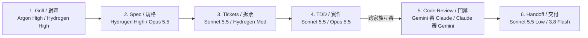

# 🛠️ Matt Pocock Agent Skills (繁體中文版)

本目錄已完整導入並建置 **Matt Pocock Agent Skills** 官方最新版之 26 個穩定版技能，所有說明與指令均已翻譯為高質量**繁體中文**，並統一對重要與關鍵技術名詞採用 `中文 (Original English)` 雙語標註格式。

> **設計哲學**：這些技能旨在幫助開發團隊與 AI Agent 建立高強度的邊界對齊與溝通機制，徹底杜絕缺乏規範的盲目編碼 (Vibe Coding)，將數十年工程經驗轉化為可重複執行的 Agent 護欄。

---

## 📂 安裝技能檔案清單 (26 穩定版技能)

### 🛠️ 工程開發 (`.agents/skills/engineering/` - 17 個技能)

- [ask-matt](./engineering/ask-matt/SKILL.md) — 諮詢 Matt Pocock 思維 (Ask Matt)
- [code-review](./engineering/code-review/SKILL.md) — 程式碼審查 (Code Review)
- [codebase-design](./engineering/codebase-design/SKILL.md) — 程式碼庫架構設計 (Codebase Design)
- [diagnosing-bugs](./engineering/diagnosing-bugs/SKILL.md) — 錯誤診斷與排錯 (Diagnosing Bugs)
- [domain-modeling](./engineering/domain-modeling/SKILL.md) — 領域模型建構 (Domain Modeling)
- [grill-with-docs](./engineering/grill-with-docs/SKILL.md) — 結合文件進行深度審視 (Grill with Docs)
- [implement](./engineering/implement/SKILL.md) — 任務實作 (Implement)
- [improve-codebase-architecture](./engineering/improve-codebase-architecture/SKILL.md) — 改善程式碼庫架構 (Improve Codebase Architecture)
- [prototype](./engineering/prototype/SKILL.md) — 快速原型開發 (Prototype)
- [research](./engineering/research/SKILL.md) — 技術調研 (Research)
- [resolving-merge-conflicts](./engineering/resolving-merge-conflicts/SKILL.md) — 解決合併衝突 (Resolving Merge Conflicts)
- [setup-matt-pocock-skills](./engineering/setup-matt-pocock-skills/SKILL.md) — 初始化技能庫設定 (Setup Skills)
- [tdd](./engineering/tdd/SKILL.md) — 測試驅動開發 (Test-Driven Development)
- [to-spec](./engineering/to-spec/SKILL.md) — 轉化為需求規格 (To Spec)
- [to-tickets](./engineering/to-tickets/SKILL.md) — 轉化為任務票券 (To Tickets)
- [triage](./engineering/triage/SKILL.md) — 任務分類與分流 (Triage)
- [wayfinder](./engineering/wayfinder/SKILL.md) — 程式碼庫導覽 (Wayfinder)

### ⚡ 生產力與對齊 (`.agents/skills/productivity/` - 5 個技能)

- [grill-me](./productivity/grill-me/SKILL.md) — 方案高強度拷問 (Grill Me)
- [grilling](./productivity/grilling/SKILL.md) — 拷問面試工作流 (Grilling)
- [handoff](./productivity/handoff/SKILL.md) — 上下文交接 (Handoff)
- [teach](./productivity/teach/SKILL.md) — 概念教學 (Teach)
- [writing-great-skills](./productivity/writing-great-skills/SKILL.md) — 編寫優質技能 (Writing Great Skills)

### 📦 工具與輔助 (`.agents/skills/misc/` - 4 個技能)

- [git-guardrails-claude-code](./misc/git-guardrails-claude-code/SKILL.md) — Git 安全護欄 (Git Guardrails)
- [migrate-to-shoehorn](./misc/migrate-to-shoehorn/SKILL.md) — 遷移至 Shoehorn (Migrate to Shoehorn)
- [scaffold-exercises](./misc/scaffold-exercises/SKILL.md) — 腳手架練習生成 (Scaffold Exercises)
- [setup-pre-commit](./misc/setup-pre-commit/SKILL.md) — 設定 Pre-commit 檢查 (Setup Pre-commit)

---

## 🚀 快速呼叫指引 (Quick Start Guide)

您可以在開發過程中使用以下指令呼叫對應的技能：

- **專案初次設定**：`/setup-matt-pocock-skills`
- **需求審視與壓力測試**：`/grill-me` 或 `/grill-with-docs`
- **測試驅動開發**：`/tdd`
- **程式碼審查**：`/code-review`

---

## 💡 相關適配使用建議 (Adaptation & Usage Recommendations)

1. **防範 Vibe Coding**：不要直接要求 Agent 生成大量未經對齊的程式碼。在大型變更前，一律先執行 `/grill-me` 或 `/grill-with-docs` 逼出隱性假設與邊界案例。
2. **遵守縫隙 (Seam) 測試**：使用 `/tdd` 時，務必先與 Agent 對齊「測試縫隙 (Test Seams)」，只在公開介面切片測試，絕不針對私有內部細節編寫脆性測試。
3. **長會話防禦**：當 Token 或會話過長時，適時執行 `/handoff` 產出交接點脈絡，再開啟新對話，避免 Agent 記憶衰退與幻覺。
4. **Issue 追蹤對齊**：善用 `.scratch/` 本地 Issue 追蹤機制，搭配 `/to-spec` 與 `/to-tickets` 將巨型需求拆解為微小可驗收的獨立單元。

---

## 🔄 閉環工作流程建議 (Closed-Loop Workflow Blueprint)

```mermaid
flowchart TD
    A[1. 初始化配置 /setup-matt-pocock-skills] --> B[2. 需求壓力測試 /grill-with-docs]
    B --> C[3. 產出需求規格 /to-spec]
    C --> D[4. 票券任務拆解 /to-tickets] /to-tickets & /triage
    D --> E[5. 任務分流與領取 /triage]
    E --> F[6. 紅綠測試驅動開發 /tdd & /implement]
    F --> G[7. 雙軸程式碼審查 /code-review]
    G -->|審查未通過| F
    G -->|審查通過| H[8. 上下文紀錄交接 /handoff]
```

### 工作流階段解析

1. **對齊階段 (Alignment)**：執行 `/setup-matt-pocock-skills` 定義追蹤器與領域文檔規約。
2. **拷問階段 (Grilling)**：透過 `/grill-with-docs` 精準對齊架構決策 (ADR) 與術語 (Glossary)。
3. **規格化階段 (Specification)**：執行 `/to-spec` 產出具備驗收條件 (Acceptance Criteria) 的 PRD，隨後執行 `/to-tickets` 拆解為單一權責 Ticket。
4. **實作階段 (Implementation)**：經由 `/triage` 領取任務，並全程嚴格遵循 `/tdd`（先紅後綠、單一切片）實作程式碼。
5. **門禁與交付階段 (Gate & Handoff)**：提交前執行 `/code-review` 進行「標準 (Standards)」與「規格 (Spec)」雙軸平行自動化驗收，最終透過 `/handoff` 自動檢核並補全 ADR 架構決策、同步領域文檔與歸檔完整交接紀錄。

---

## 🧭 模型戰力矩陣與閉環算力路由規範 (Model Routing Matrix)

本專案支援多款主力 AI 模型與思考深度（Effort）。為避免單一模型自寫自審造成的同質性盲區，並兼顧配額週期（7 天長週期 vs 當日快速重置），各閉環階段強制遵守以下模型適配與對抗式審查規範：

### 1. 核心模型家族定位清單

| 模型家族與檔位 | 核心能力特質 | 配額週期特性 | 開發定位與適用場景 |
| :--- | :--- | :--- | :--- |
| **`Gemini 4 Argon (Medium / High)`**<br>`Orchestrator (Argon)` | **全域長上下文與架構統籌之王**：超大上下文窗口、跨檔案 ADR/Spec 衝突偵測、複雜系統重構設計。 | 7 天長週期<br>*(稀缺戰略資源)* | **總架構師 / 協調者**<br>專用於 `/grill-with-docs` 大架構設計，嚴禁用於跑腿讀檔或樣板測試。 |
| **`Claude Opus 5.5 (Medium / High)`** | **極致邏輯嚴謹與邊界防禦之王**：嚴格 TypeScript 型別推導、狀態機不變量守護、複雜 Diff 手術。 | 當日快速重置<br>*(高配額重武器)* | **核心引擎實作 / 終極審查官**<br>核心計算、演算法、併發/資安與重大 Bug 排查首選。 |
| **`Claude Sonnet 5.5 (Medium / High)`** | **日常寫碼性價比與速度平衡點**：指令遵從度高、最小 Diff 精準、React/TSX 元件拆解流暢。 | 當日快速重置<br>*(高頻主力工作馬)* | **UI 與一般切片實作主力**<br>日常 80% Ticket 實作、Ticket 拆解與分支管理首選。 |
| **`Gemini 4 Hydrogen (Low ~ XHigh)`** | **高速推理與大容量脈絡推演**：支援 `XHigh` 超深思考檔位，結構化歸納極強。 | 當日快速重置<br>*(高頻主力對照)* | **規格起草 / 異質審查官**<br>`/to-spec` 規格化、Claude 寫碼後的異質 Code Review。 |
| **`Gemini 3.8 Flash (Low ~ High)`** | **極速低延遲 I/O 引擎**：超快吞吐與低延遲，適合海量檢索與模板填充。 | 當日快速重置<br>*(卸載首選)* | **子代理探勘 / 收尾歸檔**<br>`invoke_subagent` 讀檔卸載、`/handoff` 歸檔清理。 |
| **`GPT-OSS 120B (Medium)`** | **開源獨立第三視角**：跳脫 Gemini / Claude 雙體系的獨立推導。 | 當日重置 | **第三方算法驗算 / 備援** |

---

### 2. 開發閉環 8 階段最適模型配對表



| 閉環階段 | 觸發指令 | 推薦主視窗模型 | 子代理 (`Model`) 配置 | 核心選用理由與策略 |
| :--- | :--- | :--- | :--- | :--- |
| **1. 初始化配置** | `/setup-matt-pocock-skills` | **`Gemini 3.8 Flash (Med)`** 或 **`Claude Sonnet 5.5 (Low)`** | — | 純結構檢查與樣板寫入，零消耗高階配額。 |
| **2. 需求壓力測試** | `/grill-with-docs`<br>`/grill-me` | **`Gemini 4 Argon (High)`** 或 **`Gemini 4 Hydrogen (High)`** | 平行調研強制配 **`flash`** | 需要一次吞入全域文檔與業務理論。以 `flash` 子代理讀碼回傳結構化摘要，主視窗專注攻克決策樹。 |
| **3. 產出需求規格** | `/to-spec` | **`Gemini 4 Hydrogen (High)`** 或 **`Claude Opus 5.5 (Med)`** | — | 將決策收斂為嚴謹 PRD 與 Test Seams，`Hydrogen (High)` 歸納力強且當日快速回復。 |
| **4. 票券任務拆解** | `/to-tickets`<br>`/triage` | **`Claude Sonnet 5.5 (Med)`** 或 **`Gemini 4 Hydrogen (Med)`** | — | 垂直切片拆解與 DAG 拓撲計算，Medium 檔位最精確且不拖泥帶水。 |
| **5a. 核心實作**<br>*(計算/算法/安全/狀態機)* | `/tdd` + `/implement` | **`Claude Opus 5.5 (Med / High)`** 或 **`Gemini 4 Hydrogen (XHigh)`** | 局部查閱用 **`flash_lite`** | 金融級計算精度與核心引擎零容錯，先紅後綠一次命中。 |
| **5b. UI 與一般實作**<br>*(元件拆分/樣式/CRUD)* | `/tdd` + `/implement` | **`Claude Sonnet 5.5 (Med)`** 或 **`Gemini 4 Hydrogen (Med)`** | — | 本專案日常 80% 的 Ticket 類型，速度快、代碼簡潔、嚴格控制 Diff。 |
| **6. 雙軸程式碼審查** | `/code-review` | **【強制跨家族對抗式切換】**<br>• 若實作採用 **Claude** ➔ 切 **`Gemini 4 Argon / Hydrogen (High)`** 審<br>• 若實作採用 **Gemini** ➔ 切 **`Claude Opus 5.5 (Med)`** 審 | 雙軸平行審查 (`Standards` + `Spec`) | **打破同源盲區核心機制**：跨家族對邊界條件與隱性假設的敏感度互補，抓出隱蔽 Bug。 |
| **7. 上下文交接與歸檔** | `/handoff` | **`Claude Sonnet 5.5 (Low / Med)`** 或 **`Gemini 3.8 Flash (High)`** | 工作區清理與暫存檢查 | 標準化分支合併、ADR 自動補全與工作區清理，低耗能快速完成。 |

---

### 3. 日常開發 3 條黃金調度守則

1. **日常主視窗常駐檔位**：預設使用 **`Claude Sonnet 5.5 (Medium)`** 或 **`Gemini 4 Hydrogen (Medium)`**（當日快速重置池），足以平穩執行 80% 的日常切片實作與交付。
2. **高槓桿節點手動升檔**：
   - 跨系統大架構規劃 (`/grill-with-docs`) ➔ 切 **`Gemini 4 Argon (High)`**（將 7 天稀缺配額用在刀口上）。
   - 核心計量引擎與複雜演算法 (`/tdd`) ➔ 切 **`Claude Opus 5.5 (Medium/High)`** 或 **`Gemini 4 Hydrogen (XHigh)`**。
3. **門禁審查強制跨家族**：執行 `/code-review` 前，務必手動切換至「與撰寫者不同家族」的模型，實現真正的對抗式交叉審查。
