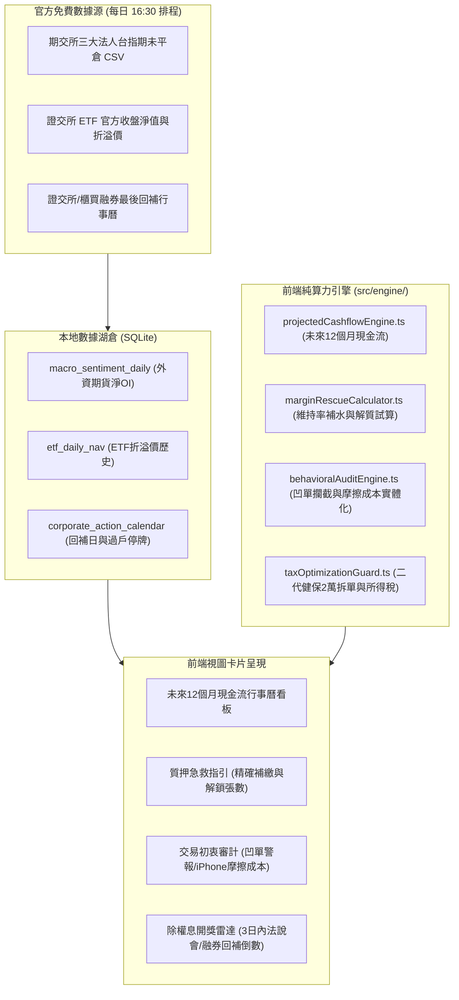

# 0183 Spec: 個人投資者法人級微觀防禦、現金流預算與極簡風控強化規格書

## 1. 概述與元數據 (Overview & Metadata)

* **規格編號：** Spec 0183
* **標題：** 個人投資者法人級微觀防禦、現金流預算與極簡風控強化
* **關聯 Issue：** [#254](https://github.com/judragon005/stock-note/issues/254)
* **關聯架構決策：** [ADR 0183](../../docs/adr/0183-personal-investor-institutional-edge-and-lean-enhancements.md)
* **規格狀態：** `DRAFT` (審查通過，準備進入 TDD 任務執行)
* **版本：** V1.0
* **建立日期：** 2026-10-15

---

## 2. 背景與動機 (Background & Motivation)

系統在完成 Spec 0001 ~ Spec 0182 後，已擁有具備 9,629 檔標的、105 萬筆日 K、25 萬筆法人與信用籌碼的本地 SQLite 湖倉 (`market_history.db`)，以及支援多券商、批次會計、質押維持率與時光機的 IndexedDB 帳簿。

然而，在引進專業券商自營與基金經理人的深水區視角進行調研後發現，個人投資者在真實日常交易與資產管理中，經常面臨以下致命盲區與心理陷阱：

1. **ETF 追高溢價與換股接刀**：
   - 散戶持有大量高股息與市值型 ETF，常在市價大幅溢價 (> 1%~3%) 時盲目追高，開盤即虧損；或在被動指數定期審核換股日，無意間接走投信倒出的成分股。
2. **做空被融券強制回補強軋**：
   - 散戶進行融券賣出或個股放空時，常忽視每年股東會與除權息前的「融券最後回補日」，在最後關頭被主力拉抬並強制在漲停板回補，損失慘重。
3. **退休與存股族的現金流枯水期焦慮**：
   - 股利多集中於 7~8 月入帳，投資人無法直觀預覽未來 12 個月每個月的預估股息現金流，難以精確規劃房貸與日常生活支出，經常面臨 4~5 月的「現金流枯水期」。
4. **報稅季意外跳級與二代健保失血**：
   - 存股族滿手高股息，每年 5 月報稅時才驚覺綜所稅率跳級 (5% 跳 12%/20%)；單筆股利超過 20,000 元被無聲扣繳 2.11% 二代健保補充保費，缺乏提前「拆單」或「出借調節」的防禦指引。
5. **質押維持率的崩跌恐慌與行動盲區**：
   - 當大盤單日重挫數百點觸發維持率預警時，使用者只看到「維持率跌至 135%」，但不知道「到底要補繳多少現金才能回升至安全線 (如 160%)」，也不知道「償還多少現金能讓券商放行解鎖股票自由變現」。
6. **人性弱點：假存股真凹單與摩擦成本失血**：
   - 波段交易者虧損時不守停損紀律，自我催眠「改成長期存股」，小虧變腰斬；頻繁進出者每年繳交數十萬手續費與證交稅，對摩擦成本毫無痛感。

為落實 **KISS 原則**，本規格書堅決**排除**機構級的過度工程（如高頻 L2 Tick、OFAC 制裁黑名單、演算法拆單分時曲面），集中火力以純本機運算與官方免費公開數據，打造個人投資者專屬的五大微觀防禦體系。

---

## 3. 核心功能規格與防禦護欄 (Functional Specifications)



### 3.1 模組一：未來 12 個月預估現金流行事曆 (Projected Cashflow Calendar)
* **輸入**：使用者在庫庫存 (`holdings`)、歷史配息記錄、已宣告之除權息行事曆 (`corporate_action_calendar`)。
* **邏輯**：
  1. 對每檔在庫持股，依據其配息頻率（月配、季配、半年配、年配）與歷史通常除息/發放月份，投影未來 12 個月（當月至未來 11 個月）的預估現金股息入帳金額。
  2. 計算「全域月均預估現金流」與「枯水期閥值 (低於月均 50% 或自訂生活費低標)」。
  3. 針對枯水月份（如通常缺乏配息之 4 月、11 月），提出「標的配息月份互補建議」。
* **輸出**：月度投影陣列 `Array<{ month: string, estimatedDividendTwd: number, isDrySeason: boolean, breakdown: Array<{ symbol, amount }> }>`。

### 3.2 模組二：質押維持率急救補水與解質變現試算器 (Margin Rescue & Unpledge Calculator)
* **輸入**：目前質押合約列表 (`loanRecords`)、當前擔保股市值、借款本金、自訂目標安全維持率（預設 160%）。
* **計算公式**：
  1. **補繳現金試算**：
     $$\text{Required Cash} = \text{Target Ratio} \times \text{Loan Principal} - \text{Collateral Market Value}$$
     （若結果 $\le 0$ 表示目前維持率已高於目標）。
  2. **增加擔保品市值試算**：
     $$\text{Required Collateral} = \frac{\text{Target Ratio} \times \text{Loan Principal} - \text{Current Collateral}}{1.0}$$
  3. **部分還款解質股票試算**：
     輸入擬解鎖標的與張數，計算償還金額後之維持率；若維持率低於 130%，計算至少需先償還多少現金本金，券商才允許解質該批股票自由賣出。
* **輸出**：維持率行動卡片，直接提供「補繳現金 NT$ X 元」或「增加擔保品 NT$ Y 元」的精確行動數字。

### 3.3 模組三：個人行為心理審計（凹單警報與摩擦成本實體化震撼）
* **交易初衷標籤 (`tradeIntent`)**：
  - 在手動新增交易或 CSV 匯入時，新增選填欄位 `tradeIntent: 'DIVIDEND' (長期存股) | 'SWING' (短波段) | 'DAY_TRADE' (當沖)`（預設依帳戶類型或標的屬性智慧推斷）。
* **凹單警報 (Bag-holding Interceptor)**：
  - 條件：當持倉之原始初衷為 `SWING` 或 `DAY_TRADE`，但持有天數已超過 60 天，且當前未實現虧損超過 **15%**。
  - 行為：在持股列表與 AI 戰情室亮起「⚠️ 偵測到波段凹單」警章，強制阻斷「轉為長期存股」的心理藉口，提示客觀停損。
* **摩擦成本震撼彈 (Friction Realizer)**：
  - 統計當年度已實現交易之累計手續費與證交稅總額。
  - 換算公式：$$\text{iPhone Equivalence} = \frac{\text{Total Friction Fees}}{40,000}$$
  - 在費用儀表板顯示：「您今年已支付摩擦成本 NT$ X 元，相當於貢獻了 N 支頂配 iPhone」。

### 3.4 模組四：二代健保 2 萬元拆單防禦與所得稅跳級警報
* **二代健保單筆 2 萬預警**：
  - 在除權息預覽與持股清單中，計算預估單筆現金股息：
    $$\text{Gross Dividend} = \text{Shares} \times \text{Cash Dividend Per Share}$$
  - 當 $20,000 \le \text{Gross Dividend} < 25,000$ 時，標記「⚠️ 觸發 2.11% 健保扣繳門檻」。
  - 提示：「若於除息前微幅調節出售 N 股，單筆股息將低於 20,000 元，可合法省下 NT$ 422 元扣繳稅款」。
* **綜合所得稅級距試算基底**：
  - 累計當年度本國應稅股利總額。
  - 對照台灣所得稅「合併計稅 (8.5% 抵減，上限 8 萬)」之臨界值 (941,176 元)，標註剩餘抵稅額度。

### 3.5 模組五：排程輕量擴充（外資台指期未平倉、ETF 折溢價與融券最後回補）
* **期交所外資台指期淨留倉 (`tw_foreign_futures_oi`)**：
  - 排程檔案：擴充 `scripts/market-sync/sync-tw-market.cjs`。
  - 來源：期交所每日 15:00 盤後開放資料 `三大法人-台股期貨未平倉`。
  - 儲存：寫入 SQLite `macro_sentiment_daily` 資料表。
* **ETF 每日收盤折溢價 (`etf_daily_nav`)**：
  - 來源：證交所官方收盤 ETF 淨值統計報表。
  - 欄位：`symbol`, `date`, `close_price`, `nav`, `premium_discount_ratio`。
  - 門檻防禦：當溢價率 $> +1.0\%$ 標註過熱，$<-1.0\%$ 標註折價。
* **融券最後強制回補行事曆 (`mandatory_buyback_date`)**：
  - 來源：證交所停券與回補公告。
  - 儲存：寫入 `corporate_action_calendar` 之 `mandatory_buyback_date` 與 `halt_start_date` / `halt_end_date`。

---

## 4. 資料庫 Schema 變更 (Database Schema Updates)

### 4.1 SQLite 數據湖倉擴展 (`sqlite-db-core.cjs`)

```sql
-- 1. ETF 每日淨值與折溢價表
CREATE TABLE IF NOT EXISTS etf_daily_nav (
  symbol TEXT NOT NULL,
  date TEXT NOT NULL,                  -- YYYY-MM-DD
  close_price REAL NOT NULL,           -- 當日市價收盤
  nav REAL NOT NULL,                   -- 官方淨值
  premium_discount_ratio REAL NOT NULL,-- 折溢價率 (%)
  updated_at INTEGER NOT NULL,
  PRIMARY KEY (symbol, date)
);
CREATE INDEX IF NOT EXISTS idx_etf_nav_symbol_date ON etf_daily_nav(symbol, date DESC);

-- 2. 擴充 macro_sentiment_daily 欄位
-- 增加外資台指期淨未平倉口數 (contracts)
-- 增加投信台指期淨未平倉口數 (contracts)
ALTER TABLE macro_sentiment_daily ADD COLUMN tw_foreign_futures_oi INTEGER;
ALTER TABLE macro_sentiment_daily ADD COLUMN tw_trust_futures_oi INTEGER;

-- 3. 擴充 corporate_action_calendar 欄位
ALTER TABLE corporate_action_calendar ADD COLUMN mandatory_buyback_date TEXT;
ALTER TABLE corporate_action_calendar ADD COLUMN halt_start_date TEXT;
ALTER TABLE corporate_action_calendar ADD COLUMN halt_end_date TEXT;
```

### 4.2 前端 IndexedDB 與資料結構擴展 (`src/types/stock.ts`)

```typescript
export type TradeIntent = 'DIVIDEND' | 'SWING' | 'DAY_TRADE';

export interface TradeRecord {
  // 既有欄位保持不變 ...
  intent?: TradeIntent; // 新增選填初衷標籤
}

export interface ProjectedCashflowItem {
  month: string; // YYYY-MM
  estimatedTotalTwd: number;
  isDrySeason: boolean; // 是否為枯水期
  details: Array<{
    symbol: string;
    name: string;
    estimatedAmountTwd: number;
    payDate?: string;
  }>;
}

export interface MarginRescuePlan {
  currentMarginRatio: number;
  targetMarginRatio: number;
  requiredCashTwd: number; // 需補繳現金
  requiredCollateralValueTwd: number; // 需增加之抵押股市值
  unpledgeAvailability: {
    canUnpledge: boolean;
    requiredRepayPrincipalTwd: number; // 需先還款多少才能釋出目標股票
  };
}
```

---

## 5. 測試策略與驗證接縫 (Testing Decisions & Seams)

遵循專案最高原則，測試一律聚焦在公開公開介面縫隙 (Test Seams) 與純邏輯計算：

1. **`projectedCashflowEngine.test.ts`**：
   - 驗證月配（如 00929）、季配（如 00878）、半年配（如 0050）、年配（如個股）的 12 個月現金流投影精準度。
   - 驗證「枯水期」閥值判定與空白月份處理。
2. **`marginRescueCalculator.test.ts`**：
   - 邊界測試：當目前維持率已高於目標值時，`requiredCashTwd` 必須回傳 0，不為負值。
   - 壓力測試：模擬抵押品重挫 20% 時，精確計算出維持 160% 所需的補繳金額。
   - 解質試算：驗證在不同股價與質押成數下，安全解鎖指定張數的最小還款額。
3. **`behavioralAuditEngine.test.ts`**：
   - 驗證波段單持有 61 天且虧損 16% 時，正確觸發 `BAG_HOLDING_ALERT`。
   - 驗證存股單 (`DIVIDEND`) 持有 180 天且虧損 20% 時，不觸發凹單警報（維持存股本質）。
   - 驗證摩擦成本之生活實體（iPhone 等價物）換算公式正確性。
4. **`taxOptimizationGuard.test.ts`**：
   - 驗證單筆股利 20,001 元觸發 2.11% 健保扣繳門檻與拆單建議。
   - 驗證單筆股利 19,999 元豁免扣繳。
5. **`syncFuturesOiAndEtfNav.test.ts`**：
   - 驗證期交所三大法人 CSV 解析與負數空單正確落庫。
   - 驗證 ETF 溢價率計算與百分比格式化。

---

## 6. 驗收標準 (Acceptance Criteria)

- [ ] **AC 1 (未來 12 個月現金流月曆)**：
  - 使用者能於資產儀表板查看未來 12 個月之預估股利入帳總額與明細。
  - 枯水期月份明確標示警章，計算邏輯 100% 通過單元測試。
- [ ] **AC 2 (質押維持率急救與解質試算)**：
  - 輸入目標維持率即可獲得精確「補繳現金」與「補繳擔保品」數額。
  - 提供安全解鎖指定張數股票的「最小先償還金額」試算，零 NaN 與零崩潰。
- [ ] **AC 3 (交易初衷與凹單攔截)**：
  - 交易明細支援設定 `intent`。
  - 短線波段單套牢逾 60 天且虧損逾 15% 時，主動警示凹單風險。
  - 費用看板具象化呈現本年度摩擦成本（iPhone 等價物）。
- [ ] **AC 4 (二代健保與報稅防禦)**：
  - 單筆股息介於 20,000 ~ 25,000 元時給出拆單避稅指引。
  - 清楚統計當年度累計應稅股息與 8.5% 抵減稅額餘額。
- [ ] **AC 5 (湖倉排程擴充與零過度工程)**：
  - SQLite 成功建立 `etf_daily_nav`，`macro_sentiment_daily` 成功擴充期貨 OI 欄位。
  - 每日 16:30 排程自動非同步抓取並落庫，零昂貴付費 API 依賴。
  - 全專案 `npm test` 通過率 100%，`npm run build` TypeScript 0 錯誤。
