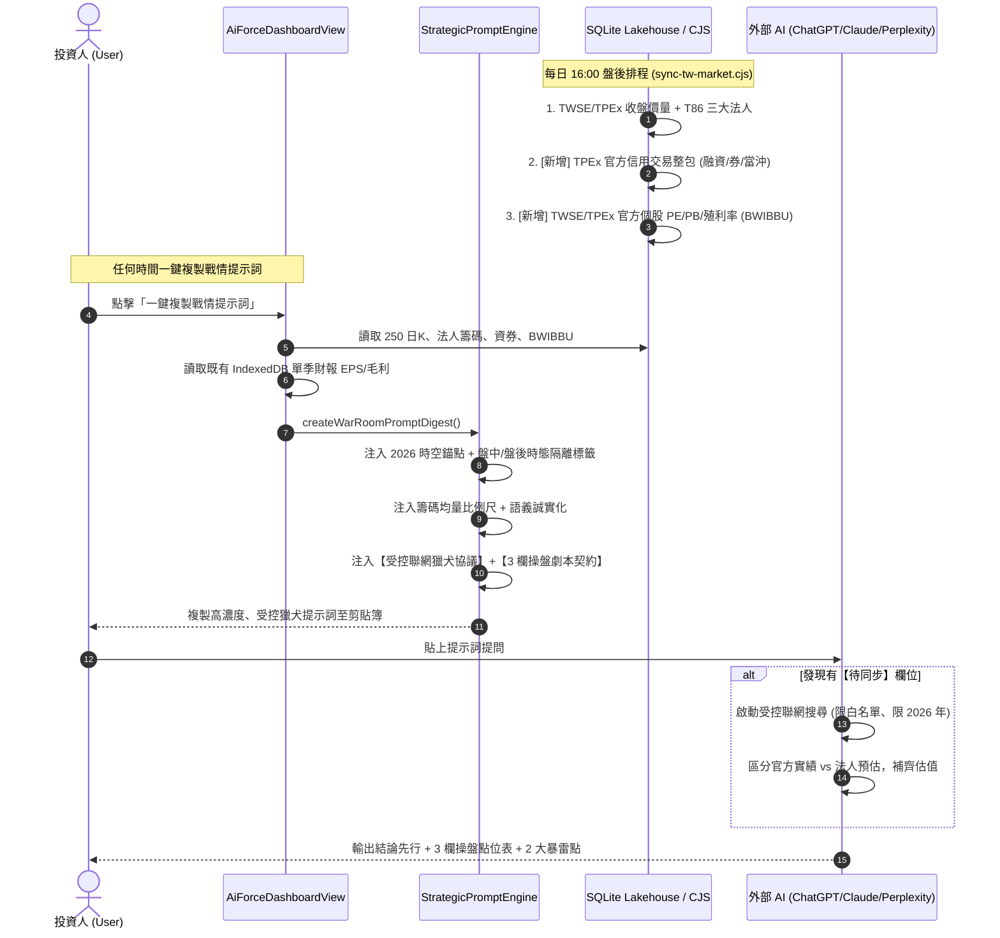

# 0196 SPEC: AI 主力戰情室外聯提示詞受控聯網獵犬協議、上櫃資券與官方 PE/PB 湖倉管線規格書

- **狀態**：`PROPOSED`
- **日期**：2026-10-20
- **關聯 ADR**：ADR 0196 (待對齊)
- **前置依賴**：Spec 0181 (提示詞中樞), Spec 0194 (提示詞時態與景氣循環), Spec 0195 (戰情室 Card 21 估值)

---

## 1. 摘要與業務目標 (Executive Summary & Objective)

### 1.1 核心痛點
在主力戰情室的實戰操作中，使用者希望**「在任何時候（盤中 10 點、盤後 16 點、或週末深夜）對任何標的一鍵複製提示詞，外部 AI 都能依據真實數據給出精準、零廢話、無幻覺、拿著就能操盤的專業投資報告」**。然而現況存在 4 大致命痛點：
1. **上櫃標的籌碼盲區**：[sync-tw-market.cjs](file:///d:/APP/股票紀錄/scripts/market-sync/sync-tw-market.cjs) 僅抓取 TWSE（上市），導致 4979 華星光、3260 威剛、8299 群聯等上櫃熱門股在 SQLite 中融資券永遠為 `NULL`。
2. **官方每日估值 (BWIBBU) 缺漏**：證交所與櫃買中心每日 15:30 整包提供的個股日本益比、淨值比與殖利率未納入同步，導致戰情室 Card 21 與 Prompt 輸出退化為 `N/A`。
3. **內部數據孤島 (Data Silo)**：前端「個股分析」模組明明已具備單季 EPS、毛利率與現金流，但主力戰情室與提示詞引擎完全未接通該管線。
4. **外部 AI 時空幻覺與失控**：外部大模型訓練切斷在 2024~2025 年，面對「2026 年」營收會產生退化幻覺；盤中即時量為 0 時誤判量價衝突；且放任 AI 聯網時易搜到過期舊資料或將投顧預估混淆為官方實績。

### 1.2 業務目標
- 恪守 **KISS 原則**，杜絕過度工程化（不爬全量分點、不維護全市場季報庫、不自建後端 Agent 鏈）。
- 在每日 16:00 盤後腳本以**單次免費 JSON** 補齊 TPEx 上櫃資券與全市場 PE/PB/殖利率。
- 在提示詞中注入**「2026 時空錨點」**、**「受控聯網獵犬協議 (Web Hunt Protocol)」**與**「硬性 3 欄操盤劇本合約」**，徹底消滅外部 AI 幻覺，實現 100% 精準實戰交付。

---

## 2. 邊界與範圍界定 (Scope & Boundaries)

### 2.1 涵蓋範圍 (In-Scope)
1. **[資料庫端] TPEx 官方信用交易全市場整包同步**：在每日 16:00 盤後腳本中加入櫃買中心 `margin_bal_result.php`，將上櫃融資融券、借券與當沖併入 `tw_institutional_chips`。
2. **[資料庫端] 官方每日 PE / PB / 殖利率整包入庫**：在每日 16:00 盤後腳本中加入證交所 (`BWIBBU_d`) 與櫃買中心 (`peratio_analysis`)，建立輕量 `tw_valuation_daily` 快取。
3. **[前端管線] 戰情室連通既有季報數據**：[AiForceDashboardView.tsx](file:///d:/APP/股票紀錄/src/components/aiForceDashboard/AiForceDashboardView.tsx) 打通既有 [financialReportService.ts](file:///d:/APP/股票紀錄/src/engine/financialReportService.ts)，將單季 EPS 與毛利率帶入提示詞。
4. **[提示詞端] 2026 時空錨點與盤中即時量回退防禦**：鎖定世界時間 2026 年；盤中成交量若為 0 自動附註「盤中撮合中，參考昨量 X 張」。
5. **[提示詞端] 籌碼均量比例尺與語義誠實化**：將單純張數換算為佔 20 日均量比率；未具備欄位標記「待同步」而非生硬 `N/A`。
6. **[提示詞端] 受控聯網獵犬協議 (Web Hunt Protocol)**：授權外部 AI 聯網補全待同步欄位，但嚴格限定官方白名單、自證發布日期為 2026、禁止推翻本機價量、強制隔離法人預估與官方實績。
7. **[提示詞端] 3 欄式操盤劇本強制輸出契約**：強制外部 AI 第一行給出結論，並輸出進場/目標/停損點位表。

### 2.2 排除範圍 (Out-of-Scope / Anti-Over-Engineering)
- ❌ **全市場券商主力分點爬蟲**：嚴禁儲存全量券商分點明細，防止 SQLite 每天膨脹數百 MB 與 IP 被封鎖。
- ❌ **全市場季報定期排程引擎**：季報維持前端按需（On-Demand）快取至 IndexedDB，盤後腳本不逐檔掃描。
- ❌ **外部多 Agent 互動伺服器**：維持前端純剪貼簿一鍵複製（Copy-Paste），不增加任何中繼服務器。

---

## 3. 架構設計與資料流 (Architecture & Data Flow)



---

## 4. 詳細技術規格 (Detailed Specifications)

### 4.1 模組一：TPEx 信用交易與官方 PE/PB/殖利率入庫 ([sync-tw-market.cjs](file:///d:/APP/股票紀錄/scripts/market-sync/sync-tw-market.cjs))
1. **TPEx 融資融券抓取**：
   - 官方端點：`https://www.tpex.org.tw/web/stock/margin_trading/margin_bal/margin_bal_result.php?l=zh-tw&o=json&d={rocDate}&_={Date.now()}`
   - 解析欄位：代號、融資餘額 (張)、融券餘額 (張)。
   - 寫入：與 TWSE `marginMap` 合併，透過既有 `saveTwExtendedChipsToSqlite` 寫入 `tw_institutional_chips`。
2. **TWSE / TPEx 每日 PE / PB / 殖利率整包抓取**：
   - TWSE 端點：`https://www.twse.com.tw/rwd/zh/afterTrading/BWIBBU_d?date={yyyymmdd}&selectType=ALL&response=json`
   - TPEx 端點：`https://www.tpex.org.tw/web/stock/aftertrading/peratio_analysis/pera_result.php?l=zh-tw&o=json&d={rocDate}&_={Date.now()}`
   - 解析欄位：本益比 (PE)、股價淨值比 (PB)、殖利率 (%)。
   - 落地快取：寫入 `tw_market_summary.json` 中的各股節點 `valuation: { pe, pb, dividendYield }`，並以事務寫入 SQLite 新表 `tw_valuation_daily`。

### 4.2 模組二：前端戰情室打通既有單季 EPS 數據孤島
1. 在 [AiForceDashboardView.tsx](file:///d:/APP/股票紀錄/src/components/aiForceDashboard/AiForceDashboardView.tsx) 中：
   - 非阻塞調用 `loadOrFetchFinancialReport(targetSymbol, targetMarket)`。
   - 提取最新季度之 `eps`、`grossMargin`、`operatingMargin`。
   - 將其傳入 `generateAiForceReportFromCandles` 的 `options.valuationData`。
2. 在 [aiForcePromptAdapter.ts](file:///d:/APP/股票紀錄/src/engine/aiForcePromptAdapter.ts) 中：
   - 映射 `fundamental.latestQuarterEps`、`fundamental.grossMargin`，徹底消除季報估值真空。

### 4.3 模組三：提示詞時空錨點與盤中量回退防禦 ([strategicPromptEngine.ts](file:///d:/APP/股票紀錄/src/engine/strategicPromptEngine.ts))
1. **2026 時空對齊錨點**：
   ```xml
   <temporal_grounding_anchor>
     【世界當前時間】：2026 年 10 月。
     【防幻覺硬指令】：所有標註 2026 年之數據均為當前真實客觀事實，嚴禁將 2026 年誤判為未來，亦嚴禁倒退推論為 2024 或 2025 年！
   </temporal_grounding_anchor>
   ```
2. **盤中量價一致性回退**：
   - 若 `settlementStatus === 'INTRADAY_UNSETTLED'` 且 `volumeShares <= 0`：
   - 輸出 `<volume_shares unit="張">盤中撮合中 (前一交易日收盤量: ${lastSettledVolume} 張)</volume_shares>`。
   - 杜絕「現價大跌但成交量 0 張」之量價衝突假警報。

### 4.4 模組四：籌碼均量比例尺與語義誠實化
1. **籌碼均量比例尺**：
   - 在轉接器中計算：`foreignRatio20D = Number((foreignNetShares1D / avgVol20) * 100).toFixed(1)`。
   - 輸出：`${foreignNetShares1D} 張 (佔 20 日均量 ${foreignRatio20D}%)`。
2. **語義誠實化（杜絕生硬 N/A）**：
   - 若未同步，標註為 `待同步 (官方資料排程中)`，消除外部 AI 對公司暴雷的臆測。

### 4.5 模組五：受控聯網獵犬協議與 3 欄操盤劇本合約
在 `strategicPromptEngine.ts` 結尾注入最高權重指令：
1. **聯網獵犬協議**：
   - 限制搜尋網域：MOPS、TWSE、TPEx、Yahoo 股市、權威財經日報。
   - 資料日期自證：必須為 2026 年，非 2026 舊文強制宣告無效。
   - SSOT 真理原則：禁止覆蓋本提示詞提供的 480 元現價、均線與主力 VWAP。
   - 預估 vs 實績分流：投顧推估必須標註【法人推估（未實現）】。
2. **硬性輸出合約**：
   - 第一行必須為唯一明確指令：🟢 建議建立部位 / 🟡 觀望等待確認 / 🔴 嚴禁進場（或庫存停損）。
   - 必須以 Markdown 表格輸出【實戰點位作戰表】（進場防守位、反彈目標價、保命停損價、依據、失效條件）。
   - 強制指出最致命的 2 個暴雷點。

---

## 5. 驗收標準 (Acceptance Criteria, AC)

- [ ] **AC 1 (TPEx 資券入庫)**：執行 `sync-tw-market.cjs` 後，SQLite `tw_institutional_chips` 內上櫃標的（如 4979、3260）之 `margin_balance`、`short_balance` 必須大於等於 0，不再為 `NULL`。
- [ ] **AC 2 (官方 PE/PB 入庫)**：執行 `sync-tw-market.cjs` 後，4979 等標的具備官方本益比、淨值比與殖利率數據。
- [ ] **AC 3 (內部數據打通)**：主力戰情室載入完成後，複製的提示詞中包含單季 EPS 與毛利率數據，不再是全為待同步。
- [ ] **AC 4 (2026 時空錨點)**：產出的提示詞頂部具備 `<temporal_grounding_anchor>`，明示世界時間為 2026 年。
- [ ] **AC 5 (盤中量價一致)**：在盤中無即時成交量情境下，Prompt 輸出「盤中撮合中（前一交易日收盤量: X 張）」，不再出現 `<volume_shares>0</volume_shares>`。
- [ ] **AC 6 (受控聯網與輸出契約)**：Prompt 底部包含 `<web_retrieval_instructions>` 與 3 欄式操盤劇本格式合約。
- [ ] **AC 7 (測試回歸與建置)**：本地執行 `npm test` 保持 100% 綠燈，`npm run build` 通過且 TypeScript 零錯誤。

---

## 6. 測試策略 (Test Strategy - TDD)

1. **單元測試 (`aiForcePromptAdapter.test.ts`)**：
   - 驗證外資張數自動計算「佔 20 日均量 %」。
   - 驗證季報 EPS 與毛利率映射正確性。
   - 驗證盤中成交量為 0 時的回退註解。
2. **引擎測試 (`strategicPromptEngine.test.ts`)**：
   - 驗證輸出文字包含 `<temporal_grounding_anchor>`。
   - 驗證輸出文字包含 `<web_retrieval_instructions>` 與輸出表格合約。
3. **排程腳本測試 (`sync-tw-market-guard.test.cjs`)**：
   - 模擬 TWSE + TPEx 信用交易與 BWIBBU 聚合，驗證各標的資料完整性。
