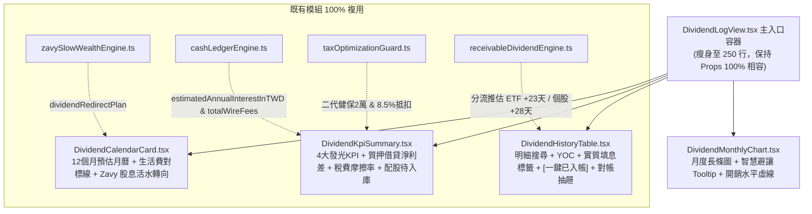

# 0225 Spec: 股利日誌與現金流全景：證交所發放日時差對齊、法人級實戰指標打通與極簡模組化重構規格書 (Dividend Log & Cashflow Holistic Refactor, Timing Alignment & Institutional Metric Unification)

## 1. 概述與元數據 (Overview & Metadata)

* **規格編號：** Spec 0225
* **標題：** 股利日誌與現金流全景：證交所發放日時差對齊、法人級實戰指標打通與極簡模組化重構 (Dividend Log & Cashflow Holistic Refactor, Timing Alignment, Real-World Spread & Modular Architecture)
* **目標版本：** v9.18.0
* **關聯 Issue：** #502
* **關聯技術債：**
  - [技術債 0051](file:///d:/APP/股票紀錄/docs/debts/0051-projected-cashflow-dynamic-calendar-profile-learning.md) (未來現金流投影慣性配息庫動態學習與跨市場擴展)
  - [技術債 0058](file:///d:/APP/股票紀錄/docs/debts/0058-dividend-log-view-subcomponent-decomposition.md) (DividendLogView 龐大單體神級組件模組化解耦重構)
* **關聯架構決策：** `docs/adr/0225-dividend-and-cashflow-holistic-refactor.md`
* **規格狀態：** `APPROVED`
* **版本：** V1.0
* **建立日期：** 2026-11-12
* **主要負責角色：** 機構法人總監 (CIO)、實戰存股退休達人、全端架構師、頂尖 Fintech UI/UX 專家

---

## 2. 問題陳述 (Problem Statement)

經過多面向多輪調研與代碼全量審查，目前專案中的「股利日誌與現金流」（主要是 `src/components/DividendLogView.tsx` 與相關引擎）存在以下五大致命痛點與架構壞味道：

### 2.1 證交所 API 先天缺陷與時序推估荒謬（錢已到帳、軟體卻顯示還要等幾天）
- 專案在 `scripts/market-sync/ingest-tw-corporate-actions.cjs` 中串接的是台灣證券交易所免費接口 `TWT48U (除權除息預告表)`。該 API 僅提供「除權除息日期」，**完全沒有「現金股利發放日 (Payment Date)」欄位**，導致寫入資料庫的 `paymentDate` 全部為空 (`undefined`)。
- `receivableDividendEngine.ts` 在缺乏官方映射時，一律死板推估為：**`除息日 + 28 天`**。
- **實務矛盾**：許多高股息 ETF（如 00878、00919、00929 等）在除息後 **20~24 天** 即由投信透過 ACH 撥付入帳。當第 22 天投資人銀行已收到款項時，系統因為判定發放日為第 28 天（`payDate > today`），**在頁面上顯示「還要等 6 天」，且硬生生將其卡在「待入帳」狀態，當年度實領股息統計也少算該筆**！

### 2.2 資訊孤島：專案現成模組黃金礦未串接 (Siloed Engines)
- **Zavy 股息活水轉向閒置**：`zavySlowWealthEngine.ts` 與 `rebalancingEngine.ts` 已經精算出大卡車/小車週期下的 `dividendRedirectPlan`（年度預估股息活水應如何注入純公債 00687B 與黃金 00635U 防禦），但股利日誌頁面完全沒有串接，形成封閉記帳孤島。
- **現金帳本對帳與累計匯費斷層**：`cashLedgerEngine.ts` 內已計算各帳戶的 `settledCash` (已交割可用現金)、`totalDividends` 與 `totalWireFees` (累計跨行匯費)，但股利頁面既未與實質入帳餘額對帳，也未提醒小資族單筆配息 < $500 被扣 $10 匯費所造成的 **高達 2%~5% 無謂摩擦損耗**。
- **質押借貸利息未抵沖 (Carry Spread Blindspot)**：實戰存股開槓桿族群（股票質押貸款利率約 2.2%~2.4% 加碼高息 ETF 6%~9%），最在意的是扣除利息後的「實質淨利差現金流」。`cashLedgerEngine` 已有 `estimatedAnnualInterestInTWD`，但股利頁面只報喜不報憂，忽略利息支出。

### 2.3 實戰心智指標缺失 (Missing Real-World Metrics)
- **缺乏 Yield on Cost (YOC, 成本殖利率)**：存股 5 年均價 25 元的標的現價 80 元，當期殖利率僅 5%，但實質 YOC 高達 16%！YOC 是長抱的核心心智模型，目前貢獻榜與明細表完全未展示。
- **缺乏含息實質總報酬標籤**：散戶常把「領很多股息」誤認為「賺很多錢」，忽略標的長期跌破除息價的貼息虧損（拿自己的本金退回還被課稅）。
- **缺乏生活開銷基準線對標**：12 個月預估月曆只有數字，沒有對標用戶每月的固定生活開銷（如 3.5 萬元），無法回答「靠股利夠不夠生活」的財富自由度 (FI Ratio)。
- **股票股利 (配股) 視覺隱形**：資料模型有 `stockDividendShares`，但介面只聚焦現金，未展示配股入庫時程。

### 2.4 單體胖組件違背 SRP (1,604 行 God Component)
- `src/components/DividendLogView.tsx` 膨脹至 1,604 行，將控制列、月曆、KPI、長條圖、貢獻榜、對帳面板、明細表全塞在單一檔案內，包含大量重複的 `filter` 與算稅邏輯，維護極易顧此失彼。

### 2.5 UI/UX 弊病：垂直卡片大瀑布與數字抖動
- 頁面單向垂直堆疊，筆電螢幕需滾動 4~5 頁才能看完；數字未採用等寬排版 (`tabular-nums`) 產生視覺抖動；月曆在窄螢幕擠壓折行。

---

## 3. 解決方案 (Solution)

依循 **KISS 原則**、**第一性原理** 與 **100% 複用專案既有模組** 的準則，落實以下五大升級維度：



### 3.1 消除發放日時差：分流推估 +「一鍵已入帳」微操作
1. **分流推估演算法**：優化 `estimatePaymentDate`，針對 ETF 標的（以代碼 `00` 開頭或具備 ETF 標籤者）預設時滯由 28 天修正為 **23 天**；一般個股維持 **28 天**。
2. **「一鍵已入帳 (Instant Settle)」微按鈕**：在應收股利與明細表待入帳項目中，提供快捷按鈕：點擊後立即將 `payDate` 定錨為今日並轉為已結算狀態，**瞬間納入實領統計與現金帳本**。
3. **時序事實標註**：清楚標記 `[官方公告日]` 或 `[演算法推估]`。

### 3.2 串接現成模組黃金礦 (100% 複用，零造輪子)
1. **Zavy 股息活水轉向導流卡**：在預估行事曆下方呈現一列指引：「本年度預估入帳股息 **NT$ XX 萬**，依目前景氣波浪建議活水轉向注入：**純公債 (00687B)** 與 **黃金儲備 (00635U)**，實現存量不動、增量抗震。」
2. **質押借貸淨利差現金流 (Net Carry Spread)**：在 KPI 區域引入 `cashLedgerEngine.ts` 之利息支出，展示 `實領股息 - 借貸利息 = 實質淨利差現金流`。
3. **累計匯費與微型配息警報**：統計累計跨行匯費，並對單筆配息 < $500 扣除 $10 匯費者提示「建議變更保管銀行」。

### 3.3 實戰心智指標與生活費開銷對標
1. **YOC (成本殖利率) 與實質填息標籤**：在貢獻榜與明細表並列顯示 `YOC: XX.X%`，並標註 `[實質填息]` 或 `[貼息中 / 本金返還]`。
2. **生活費開銷目標對齊線**：月曆與長條圖疊加「每月生活開銷目標（預設 35,000 元，可微調）」，展示 **月均覆蓋率 %** 與 **枯水期斷糧警示**。
3. **股票股利 (配股) 入庫追蹤**：在應收卡片同步顯示待入庫配股股數與預估上市日。

### 3.4 單體組件極簡拆分 (4 個高內聚子模組)
保持 `DividendLogViewProps` 介面 100% 向後相容，將 `DividendLogView.tsx` 瘦身為總指揮容器，拆分為 4 個專注子組件（位於 `src/components/dividend/`）：
- `DividendCalendarCard.tsx`
- `DividendKpiSummary.tsx`
- `DividendMonthlyChart.tsx`
- `DividendHistoryTable.tsx`

### 3.5 UI/UX 金融控制台網格與等寬排版
- 採用 2×2 複合控制台網格，消除單向長瀑布滾動；
- 全量應用 `font-variant-numeric: tabular-nums`；
- 語義色彩嚴格隔離（股利翡翠綠、損益台股紅漲綠跌、枯水期琥珀橘）。

---

## 4. 使用者故事 (User Stories)

1. **作為存股投資人**，當我網銀已經收到股利時，我希望在系統上能點擊「一鍵已入帳」，而不是眼睜睜看著頁面顯示「還要等 6 天」，以便立即看到真實入帳統計。
2. **作為退休規劃者**，我希望在月曆上看到每月股利對標我 35,000 元生活費的覆蓋率，並在枯水期前獲得提醒，以便提前準備現金防護墊。
3. **作為長期存股族**，我希望看到我的「成本殖利率 (YOC)」，而不只是當期殖利率，以感受時間複利的護城河。
4. **作為開槓桿質押投資人**，我希望看到扣除質押貸款利息後的「實質淨利差現金流」，以便掌握真實可支配被動所得。
5. **作為慢富資產配置者**，我希望領到股息時，系統能直接告訴我該把這筆活水導流至哪檔公債或防禦資產，而不是放著發霉。
6. **作為前端工程師**，我希望股利頁面由清晰的子組件組成，以便各模組獨立測試、互不干擾，杜絕修改 A 破壞 B。

---

## 5. 架構決策與型別契約 (Implementation Decisions & Contracts)

### 5.1 主入口相容介面 (`src/components/DividendLogView.tsx`)
```typescript
export interface DividendLogViewProps {
  trades: TradeRecord[];
  holdings?: HoldingPosition[];
  receivableDividends: ReceivableDividend[];
  usdToTwdRate: number;
  market?: 'ALL' | MarketType;
  selectedAccountId?: string;
  onSyncCorporateActions?: () => void;
  isSyncingCorporateActions?: boolean;
  onInstantSettleDividend?: (dividendId: string, actualPayDate: string) => void; // 增強：一鍵入帳回調
}
```

### 5.2 四個子組件型別合約 (`src/components/dividend/`)

#### 1. `DividendCalendarCardProps`
```typescript
export interface DividendCalendarCardProps {
  projectedCashflow: ProjectedCashflowResult;
  complementaryRecommendations: ComplementaryRecommendation[];
  taxStats: DividendTaxDeductionStats;
  targetMonthlyExpenseTwd?: number; // 預設 35,000 元
  onTargetExpenseChange?: (val: number) => void;
  zavyDividendPlanSummary?: string; // 複用 zavySlowWealthEngine 活水轉向指引
  isCashflowExpanded: boolean;
  onToggleExpand: () => void;
}
```

#### 2. `DividendKpiSummaryProps`
```typescript
export interface DividendKpiSummaryProps {
  selectedYear: number;
  dividendDisplayMode: DividendDisplayMode; // 'GROSS' | 'NET'
  onToggleDisplayMode: (mode: DividendDisplayMode) => void;
  currentYearGrossTWD: number;
  currentYearNetTWD: number;
  currentYearTaxTWD: number;
  totalReceivableTWD: number;
  totalHistoricalNetTWD: number;
  nhiAlertCount: number;
  pendingStockSharesTotal: number;
  estimatedLoanInterestTWD?: number; // 複用 cashLedgerEngine：質押利息支出
  totalWireFeesTWD?: number;         // 複用 cashLedgerEngine：累計匯費
}
```

#### 3. `DividendMonthlyChartProps`
```typescript
export interface DividendMonthlyChartProps {
  monthlyDistribution: MonthlyDividendDistribution[];
  maxMonthlyNet: number;
  targetMonthlyExpenseTwd?: number;
  dividendDisplayMode: DividendDisplayMode;
  selectedYear: number;
}
```

#### 4. `DividendHistoryTableProps`
```typescript
export interface DividendHistoryTableProps {
  dividendTrades: TradeRecord[];
  allScopedTrades: TradeRecord[];
  holdings: HoldingPosition[];
  selectedYear: number;
  searchQuery: string;
  onSearchChange: (q: string) => void;
  tableYearFilter: 'SELECTED_YEAR' | 'ALL';
  onTableYearFilterChange: (filter: 'SELECTED_YEAR' | 'ALL') => void;
  rankMode: 'YEAR' | 'ALL_TIME';
  onRankModeChange: (mode: 'YEAR' | 'ALL_TIME') => void;
  activeContributors: DividendContributor[];
  reconciliationList: AnnualReconciliationItem[];
  showReconciliationPanel: boolean;
  onToggleReconciliationPanel: () => void;
  onInstantSettle?: (tradeId: string) => void;
}
```

---

## 6. 驗收標準 (Acceptance Criteria)

- [ ] **AC-1 (時序時差修復)**：
  - 針對 ETF 標的，預估發放日時滯自動採用 23 天；個股維持 28 天。
  - 待入帳項目提供「一鍵已入帳」按鈕，點擊後 `payDate` 定錨為今日並轉為已結算，即時加總至實領股息。
  - 項目明確標記 `[官方公告]` 或 `[演算法推估]`。
- [ ] **AC-2 (Zavy 股息活水轉向串接)**：
  - 預估月曆卡片下方顯示 `zavySlowWealthEngine` 計算之股息活水轉向建議（純公債 00687B / 黃金 00635U）。
- [ ] **AC-3 (實戰生活費與 YOC 指標)**：
  - 月曆與長條圖具備 35,000 元生活費對標水平線與月均覆蓋率 %。
  - 標的貢獻榜與明細表正確呈現 `YOC: XX.X%`，並標示 `[實質填息]` 或 `[貼息中]`。
- [ ] **AC-4 (質押借貸利差與匯費)**：
  - KPI 卡片呈現借貸利息支出與實質淨利差現金流，並統計累計跨行匯費。
- [ ] **AC-5 (組件拆分與無損重構)**：
  - `src/components/DividendLogView.tsx` 縮減為總指揮容器，拆解出 4 個高內聚子組件。
  - 原有單元測試（永豐金配股健保、Tooltip 避讓等）100% 綠燈通過。
- [ ] **AC-6 (TypeScript 零錯誤與零外部套件)**：
  - `npm test` 100% 通過，`npm run build` TypeScript 0 錯誤。

---

## 7. 測試計畫與情境 (Test Plan & Scenarios)

1. **單元測試 (`DividendLogView.test.ts`)**：
   - 驗證「一鍵已入帳」將待發放款項即時轉化為實領之時序事實。
   - 驗證 ETF (+23天) 與個股 (+28天) 之發放日分流推估精準度。
   - 驗證借貸利差計算（股息收入扣除利息支出）之邊界情況。
   - 驗證 YOC 與實質填息標籤判定邏輯。
   - 保持既有測試（永豐金配股合併健保計算、Tooltip 避讓演算法）100% 通過。
2. **整合測試**：
   - 驗證切換年度、切換市場（台股/美股/全市場）及切換帳戶時，子組件資料即時聯動無滯後。
3. **無迴歸驗證 (Regression Guard)**：
   - 確保外部調用端引用 `DividendLogView` 時無任何語法破壞。
