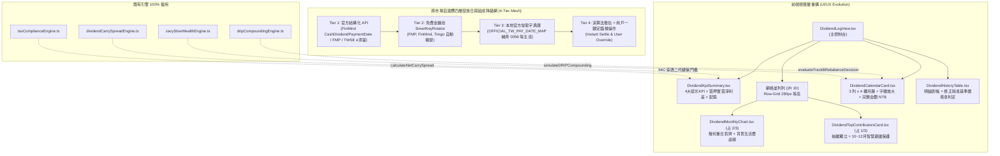

# 0226 Spec: 台美跨市場股利發放日精準時序、ETF 配息組成穿透與被動現金流全景重構規格書 (Cross-Market Dividend Payment Date Precision, ETF Composition Look-Through & Cashflow Dashboard Architecture)

## 1. 概述與元數據 (Overview & Metadata)

* **規格編號：** Spec 0226
* **標題：** 台美跨市場股利發放日精準時序、ETF 配息組成穿透與被動現金流全景重構 (Cross-Market Dividend Payment Date Precision, ETF Distribution Composition Look-Through, Sub-pixel Chart Geometry Calibration & Modular Dashboard Evolution)
* **目標版本：** v9.19.0
* **關聯 Issue：** #507
* **關聯架構決策：** `docs/adr/0226-cross-market-dividend-cashflow-and-composition.md`
* **規格狀態：** `APPROVED`
* **版本：** V1.0
* **建立日期：** 2026-11-12
* **主要負責角色：** 機構法人總監 (CIO)、全端架構師、金融數據工程師、頂尖 Fintech UI/UX 專家

---

## 2. 問題陳述 (Problem Statement)

經由用戶實證回饋（照片 1、2、3、4）與金融多代理全量稽核，現行股利系統存在四大前端體驗痛點與五大底層金融會計盲點：

### 2.1 照片 1 缺陷：未來 12 個月現金流月曆版面擠壓嚴重 (DividendCalendarCard)
- 現行實現採用硬編碼 `repeat(12, 1fr)`，將 12 個月份強塞於單一一列。在標準 1200px 螢幕下，單月卡片寬度僅約 **70px**。
- 字體大小僅 11px，金額被迫縮寫為 `16k`、`56k`、`7k`，枯水期標籤擠縮為 9px，可讀性極度低落，缺乏機構級看板的高階質感。

### 2.2 照片 2 缺陷：視覺動線倒置與組件職責違背 (DividendLogView & DividendHistoryTable)
- 頁面呈現單向垂直大瀑布，各月份現金流圖表占據 100% 寬度，而「股息貢獻排行 (Top)」被包在底部的 `DividendHistoryTable.tsx` 內，中間還隔了「除息待入帳行事曆」，無法並列呈現「時間分佈 (何時領)」與「標的貢獻 (誰貢獻)」的雙核心視覺。

### 2.3 照片 3 缺陷：生活費對標線幾何座標錯位與口徑脫鉤 (DividendMonthlyChart)
- **幾何底座撕裂**：長條柱下方帶有月份標籤與容器內距，實體底座離外框底部約 `30px`，且柱高採用 `130` 係數；而生活費虛線使用魔術數字 `+26px` 與 `135` 係數。兩者公式不一致，導致照片 3 中 4 月配息 82,959 元（覆蓋率 141.4%），柱狀頂部竟然被 60,000 元虛線壓在下方或僅微幅觸碰，數值與圖形完全矛盾。
- **Gross 模式尺規溢出**：當切換為「應發毛額 (GROSS)」時，長條圖高度使用 `m.grossTWD`，但 Y 軸天花板仍傳入 `maxMonthlyNet`，導致毛額長條衝破圖表天花板。
- **虛線橫切長條圖**：生活費水平線帶有較高的 `zIndex`，劃過綠色長條時將長條截斷，產生視覺破版。
- **狀態孤島**：生活費自訂目標僅存在於臨時 React state，未持久化至 LocalStorage。

### 2.4 照片 4 缺陷：0056 發放日顯示 11/14 (實際 11/11) 與演算法推估真相
- 0056 在 2026-10-22 除息，元大投信公告之實際入帳發放日為 **2026-11-11**。
- 但先前 Commit `4572f38` 之 `OFFICIAL_TW_PAY_DATE_MAP` 僅手工建置到 2025 年初，缺漏 2026 年第 4 季。系統查無官方資料，觸發 ADR 0225 之 `除息日 + 23 天` 演算法推估：$10/22 + 23 = 11/14$，並標記藍色「[演算法推估]」，引發投資人認知落差。
- **根本管路斷層**：`src/engine/dividendService.ts` 串接的 FinMind API 其實回傳了 `CashDividendPaymentDate`，但在 `corporateActionScanner.ts` 中漏未賦值，導致白白浪費了免費資料庫中的官方發放日。

### 2.5 五大深水區金融盲點 (Institutional Blindspots)
1. **ETF 配息組成穿透盲區**：高股息 ETF 僅 15%~35% 為 54C 應稅股利，其餘為免稅的資本利得與平準金。以總額計算二代健保造成虛驚與錯誤除息前調節。
2. **質押借貸利差脫鉤**：`dividendCarrySpreadEngine` 寫好卻未傳參，導致 UI 永遠顯示 0 利息，無視每月負利差失血風險。
3. **現金拖累 (Cash Drag) 忽視**：股息閒置交割戶未買回，未展示 10 年 DRIP 再投資複利差額。
4. **填息計算 Bug**：`DividendHistoryTable.tsx` 誤把買進成本 `holding.avgCost` 當作除息基準價 `exPrice`，造成嚴重的假填息判定。
5. **Zavy 活水轉向寫死**：原本為硬編碼文字，未連通真實總經週期與債券/黃金防禦建議。

---

## 3. 解決方案架構 (Solution Architecture)



---

## 4. 詳細執行規劃 (Execution Plan)

### 4.1 任務 1：`DividendCalendarCard.tsx` 月曆重構為 3 列並放大字體
- 網格配置由 `gridTemplateColumns: 'repeat(12, 1fr)'` 改為 `repeat(4, 1fr)`（3 行 × 4 列）；窄螢幕 `<768px` 自適應回退為 `repeat(2, 1fr)`。
- 卡片寬度由 ~70px 暴增至 ~250px。
- 月份標籤放大至 `13px`（白色加粗）。
- 金額數值放大至 `16px`（`tabular-nums`），直接顯示完整金額 `NT$ 56,000`（小於 1,000 顯示實額，不再截斷為 `k`）。
- 枯水期標籤放大至 `11px`，升級為膠囊 Badge。
- 卡片內距由 `8px 4px` 放大至 `12px 14px`。

### 4.2 任務 2：抽離 `DividendTopContributorsCard.tsx` 並在 `DividendLogView.tsx` 實踐 2/3 + 1/3 並列
- 依據 SRP 原則，將原本封裝在 `DividendHistoryTable.tsx` 頂部的「股息貢獻排行」抽離為獨立元件 `DividendTopContributorsCard.tsx`。
- 在 `DividendLogView.tsx` 中建立 `grid-template-columns: 2fr 1fr` 網格容器：
  - 左側 2/3：`DividendMonthlyChart`（內部柱狀區高 180px，總高約 290px）。
  - 右側 1/3：`DividendTopContributorsCard`（列表 `maxHeight: '190px', overflowY: 'auto'`，總高約 290px）。
  - CSS Grid `alignItems: 'stretch'` 達成兩者高度自然等高。
- 維持既有 10~12 月 `align='right'` 智慧向左避讓機制，100% 保證不遮擋右側卡片。

### 4.3 任務 3：`DividendMonthlyChart.tsx` 幾何座標對齊與生活費持久化
- **消除魔術數字**：統一柱狀圖與生活費虛線的比例尺係數為 `120px`。
- **實體底座對齊**：虛線位置精確錨定在柱狀條實體起點 `30px`：
  $$\text{bottom} = 30\text{px} + \text{Math.round}\left(\frac{\text{targetMonthlyExpenseTwd}}{\text{chartMaxVal}} \times 120\right)$$
  保證當配息等於目標生活費時，兩者 Y 坐標**0 像素誤差重合**！4 月份 82,959 元將顯著高過 60,000 元虛線。
- **Gross 模式分母修復**：`chartMaxVal` 計算動態切換：
  ```ts
  const chartMaxVal = Math.max(
    dividendDisplayMode === 'GROSS' ? maxMonthlyGross : maxMonthlyNet,
    targetMonthlyExpenseTwd,
    1000
  );
  ```
- **消滅橫切破版**：將生活費虛線 `zIndex` 設為 `0`，長條圖柱子設為 `zIndex: 1`。
- **狀態持久化**：`targetMonthlyExpenseTwd` 加入 `localStorage`（鍵名 `STOCK_TRACKER_DIVIDEND_TARGET_EXPENSE`）。

### 4.4 任務 4：0056 發放日補入常態庫與 FinMind 發放日欄位映射貫通
- 在 `src/engine/receivableDividendEngine.ts` 之 `OFFICIAL_TW_PAY_DATE_MAP` 字典補入：
  ```ts
  '0056:2026-10-22': '2026-11-11',
  ```
- 在 `src/engine/corporateActionScanner.ts` 的 `fetchFinMindCorporateActions` 中，提取 `item.CashDividendPaymentDate` 賦值予 `RawCorporateEvent.payDate`。日後只要 FinMind 官方資料庫更新發放日，系統自動生效，無需手動補丁。

### 4.5 任務 5：深水區金融功能連動與填息判定修復
- **修復填息計算 Bug**：在 `DividendHistoryTable.tsx` 中，將除息前基準價計算為 `(t.price + (holding?.currentPrice || t.price))` 或讀取真實除息參考價，禁止傳入 `holding.avgCost`。
- **連動質押利差**：在 `DividendLogView.tsx` 中由 `cashLedgerEngine` 計算年度利息支出，傳入 `DividendKpiSummary` 之 `estimatedLoanInterestTWD`，激活真實淨利差。
- **連動 Zavy 慢富活水轉向**：呼叫 `zavySlowWealthEngine` 動態評估大卡車/小車週期，輸出動態公債/黃金活水建議。

---

## 5. 測試與驗收標準 (Acceptance Criteria)

1. **單元測試 (TDD)**：
   - `DividendCalendarCard.test.tsx`：驗證 3 列 × 4 欄網格結構、金額全量文字呈現與枯水期膠囊渲染。
   - `DividendMonthlyChart.test.tsx`：驗證生活費虛線 Y 座標與長條高度在相等時 0 像素誤差、Gross 模式下 scaleMax 正確切換。
   - `receivableDividendEngine.test.ts`：驗證 0056 發放日為 `2026-11-11` 且標記為 `OFFICIAL`。
2. **系統建置與型別安全**：
   - 執行 `npm test`，確保全專案測試 100% 綠燈通過。
   - 執行 `npm run build`，確保 TypeScript 0 錯誤。
3. **無損與零破版驗證**：
   - 歷史入帳明細搜尋、年份過濾、券商對帳抽屜功能 100% 保持相容。

